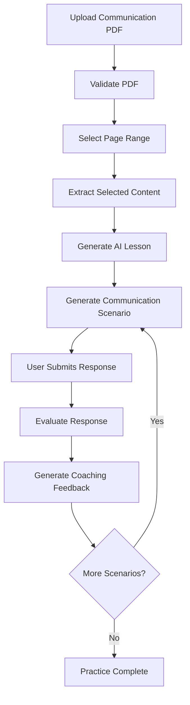

# CoachMind AI – AI-Powered Communication Coach

An AI-powered communication learning and practice platform that helps users improve their professional communication skills through personalized lessons, real-world scenarios, and AI-driven feedback.

## Overview

CoachMind AI is designed to help individuals develop effective communication skills for professional situations such as workplace conversations, client meetings, interviews, and other professional interactions.

Instead of relying only on theoretical learning, the platform transforms communication-related learning material into structured lessons and practical scenarios. Users can practice their responses and receive personalized feedback to understand their strengths and areas for improvement.

The goal is to make communication learning practical, interactive, and personalized.

## Problem Statement

Many individuals understand the importance of effective communication but struggle to apply communication principles in real-life professional situations.

Traditional learning resources often focus on explaining concepts without providing enough opportunities to practice them in realistic situations.

Learners may also find it difficult to identify weaknesses in their communication style or understand how to improve their responses.

CoachMind AI addresses these challenges by combining structured learning, scenario-based practice, and AI-powered evaluation.

## Project Status

 CoachMind AI is currently under active development. The application is designed to run locally, and deployment is planned for a future release.

## Key Features

### 1. PDF-Based Learning

- Upload communication-related PDF books.
- Validate uploaded PDF files.
- Detect duplicate uploads.
- Extract content from selected pages.
- Convert learning material into structured lessons.

### 2. AI-Generated Lessons

- Generate lessons from selected learning material.
- Identify important communication principles.
- Present relevant rules and examples.
- Provide clear learning objectives.
- Organize extracted knowledge into an understandable format.

### 3. Real-World Scenario Generation

- Generate practical communication scenarios based on lesson concepts.
- Support workplace, client meeting, interview, and public speaking situations.
- Create different scenarios for practice.
- Encourage users to apply learned communication principles.

### 4. Response Evaluation

Evaluate user responses based on communication effectiveness, including:

- Clarity
- Confidence
- Grammar
- Empathy
- Relevance to the situation
- Application of communication principles

### 5. AI-Powered Coaching and Feedback

- Evaluate responses in context.
- Identify communication weaknesses.
- Explain mistakes and suggest improvements.
- Provide actionable feedback.
- Encourage users to improve their responses through practice.

### 6. Progressive Practice

- Practice multiple scenarios from a lesson.
- Receive evaluation and coaching after each response.
- Continue practicing with subsequent scenarios.
- Complete a structured practice sequence.

## Technology Stack

| Component | Technology |
|---|---|
| Frontend | React.js |
| Frontend tooling | Vite |
| Styling | Tailwind CSS |
| Backend | Python, FastAPI |
| Database | SQLite |
| ORM | SQLAlchemy |
| AI model | Google Gemini API |
| PDF processing | PyMuPDF |
| OCR | Tesseract OCR, Pytesseract |
| Environment configuration | Python Dotenv |
| Version control | Git and GitHub |

## System Architecture

CoachMind AI follows a modular full-stack architecture.

### Frontend

The React frontend provides the user interface for:

- PDF uploads
- Lesson generation
- Lesson presentation
- Scenario-based practice
- Response submission
- Evaluation and feedback

### Backend

The FastAPI backend manages application logic, data processing, AI integration, and communication between the frontend and database.

The backend is organized into the following modules:

| Module | Responsibility |
|---|---|
| `database` | Database connection and initialization |
| `upload_book` | PDF upload, validation, duplicate detection, and storage |
| `lesson` | Lesson generation and management |
| `ai` | Gemini API integration and AI orchestration |
| `scenario` | Communication scenario generation |
| `response` | User response handling |
| `evaluation` | Response evaluation |
| `coaching` | Personalized communication feedback |
| `practice` | Practice workflow management |

### Database

SQLite is used for persistent application data, with SQLAlchemy handling database operations and ORM relationships.

## Application Workflow

The main application workflow is:

1. **Upload PDF:** The user uploads a communication-related PDF.
2. **Validate Document:** The backend validates the file, checks for duplicates, and verifies its structure.
3. **Select Learning Material:** The user selects the pages they want to study.
4. **Generate Lesson:** The AI processes the selected content and generates a structured lesson.
5. **Generate Scenario:** The system creates a realistic communication scenario based on the lesson.
6. **Submit Response:** The user writes a response to the given situation.
7. **Evaluate Response:** The AI evaluates the response against relevant communication criteria.
8. **Provide Coaching:** The system explains areas for improvement and provides actionable feedback.
9. **Continue Practice:** The user proceeds to the next scenario.

### Workflow Diagram



## Project Structure

The project follows a modular frontend-backend structure.

```text
CoachMind-AI/
│
├── backend/
│   ├── app/
│   │   ├── database/
│   │   ├── upload_book/
│   │   ├── lesson/
│   │   ├── ai/
│   │   ├── scenario/
│   │   ├── response/
│   │   ├── evaluation/
│   │   ├── coaching/
│   │   ├── practice/
│   │   └── main.py
│   │
│   ├── uploads/
│   ├── requirements.txt
│   └── .env
│
├── frontend/
│   ├── src/
│   │   ├── api/
│   │   ├── assets/
│   │   ├── components/
│   │   ├── pages/
│   │   ├── styles/
│   │   ├── utils/
│   │   ├── App.jsx
│   │   ├── index.css
│   │   └── main.jsx
│   │
│   ├── public/
│   ├── package.json
│   └── vite.config.js
│
└── README.md
```


## Getting Started (Local Development)

Follow these steps to run CoachMind AI locally.

### Prerequisites

Install the following:

- Python 3.10 or later
- Node.js and npm
- Git
- Tesseract OCR
- A Google Gemini API key

### 1. Clone the Repository

```bash
git clone <YOUR_GITHUB_REPOSITORY_URL>
cd CoachMind-AI
```

### 2. Backend Setup

Navigate to the backend directory:

```bash
cd backend
```

Create a virtual environment:

```bash
python -m venv venv
```

Activate it on Windows PowerShell:

```powershell
.\venv\Scripts\Activate.ps1
```

Install Python dependencies:

```bash
pip install -r requirements.txt
```

### 3. Environment Configuration

Create a `.env` file inside the backend directory.

Add your Gemini API key:

```env
GEMINI_API_KEY=your_gemini_api_key
```

Replace the placeholder with your actual API key.

**Important:** Never commit your `.env` file or expose your API key publicly.

### 4. Tesseract OCR Setup

Install Tesseract OCR on your system.

Ensure that the executable path configured in the PDF processing module matches your local installation.

Example Windows path:

```text
C:\Program Files\Tesseract-OCR\tesseract.exe
```

### 5. Run the Backend

From the backend directory, execute:

```bash
uvicorn app.main:app --reload
```

The backend will run at:

```text
http://localhost:8000
```

FastAPI interactive API documentation:

```text
http://localhost:8000/docs
```

### 6. Frontend Setup

Open another terminal and navigate to the frontend directory:

```bash
cd frontend
```

Install dependencies:

```bash
npm install
```

Start the Vite development server:

```bash
npm run dev
```

The frontend will run at:

```text
http://localhost:5173
```

## API Overview

The backend exposes REST API endpoints for the main application workflows.

| Module | Endpoint | Method | Purpose |
|---|---|---|---|
| Upload | `/upload-book/` | POST | Upload a PDF |
| Upload | `/upload-book/` | GET | Retrieve uploaded PDFs |
| Lesson | `/lessons/` | Depends on implementation | Lesson operations |
| Scenario | `/scenarios/` | Depends on implementation | Scenario operations |
| Response | `/responses/` | Depends on implementation | Submit responses |
| Evaluation | `/evaluations/` | Depends on implementation | Evaluate responses |
| Practice | `/practice/` | Depends on implementation | Practice workflow |

For exact endpoint paths and request schemas, refer to the FastAPI documentation at `/docs`.

## AI Integration

Google Gemini is integrated into the backend through a dedicated AI layer.

The AI orchestration layer separates model communication from individual application modules.

This allows different modules to use the AI service for specific tasks, including:

- Lesson generation
- Communication scenario generation
- Response evaluation
- Personalized coaching feedback

The backend manages application logic and data validation, while Gemini handles tasks that require language understanding and reasoning.

## Database and File Storage

- SQLite stores application records.
- SQLAlchemy manages database operations.
- Uploaded PDF files are stored locally.
- PDF metadata and relevant application information are maintained in the database.
- The application uses modular database models for its major workflows.

## Future Enhancements

Potential areas for future development include:

- More advanced communication evaluation.
- Improved personalization based on individual learning patterns.
- Detailed communication performance analytics.
- Additional scenario categories.
- Enhanced feedback and coaching capabilities.

## Contributing

Contributions, suggestions, and feedback are welcome.

For major changes, consider opening an issue to discuss the proposed improvement before submitting a pull request.

## License

This project is currently under development. Add an appropriate license before distributing or publishing it as an open-source project.

---

**CoachMind AI — Learn the principles. Practice real conversations. Communicate with confidence.**